<a href="https://andresbrinez.com">
  <picture>
    <source media="(prefers-color-scheme: dark)" srcset="assets/cabecera-oscura-es.svg">
    <source media="(prefers-color-scheme: light)" srcset="assets/cabecera-clara-es.svg">
    
  </picture>
</a>

<p align="center">
  <a href="https://andresbrinez.com">andresbrinez.com</a> ·
  <a href="https://www.linkedin.com/in/acbri/">LinkedIn</a> ·
  <a href="mailto:contacto@andresbrinez.com">contacto@andresbrinez.com</a>
  <br>
  <a href="README.md">English</a> · <b>Español</b>
</p>

**Ingeniería de IA, datos y Odoo ERP para empresas · Quito, Ecuador (UTC-5)**

Construyo IA que se hace cargo de un paso real de su trabajo. Lee sus
documentos, escucha sus reuniones y llamadas, responde con sus datos y actúa
en los sistemas que ya usa. Detrás, datos limpios y Odoo ERP para las
finanzas: contabilidad, facturación electrónica e impuestos.

El fin es que una empresa mediana opere como operan las grandes. Usted
recibe el alcance por escrito antes de empezar y resultados que puede
comprobar.

## Qué hago hoy

Trabajo por mi cuenta. **Andrés Briñez** es mi propia empresa, en Quito
desde septiembre de 2026. Opera con su propio producto:
[andresbrinez.com](https://andresbrinez.com) es un Odoo 19 Community
autohospedado que sirve desde un solo sistema el sitio público en dos
idiomas, el portal de cliente, el CRM, las cotizaciones y la facturación.

Lo que me puede entregar:

- **Un agente de IA para su proceso.** Claude con herramientas que leen y
  escriben en su ERP, su base de datos o sus archivos, con los límites que
  usted fije.
- **Respuestas sobre sus documentos (RAG).** Búsqueda con embeddings y
  pgvector, medida con preguntas de prueba, para saber cuántas veces
  acierta.
- **Audio convertido en trabajo.** Transcripción con Whisper,
  reconocimiento de quién habla y actas o resúmenes escritos por un LLM.
- **Datos que hay que mover o conectar.** Python y PostgreSQL,
  integraciones por API y n8n.
- **Odoo ERP para finanzas.** Contabilidad, facturación electrónica e
  impuestos de Ecuador y Colombia.

## Lo que he construido

- **Reunia, actas de reunión con IA que saben quién habló.** Transcribe el
  audio con Whisper, reconoce a cada hablante entre reuniones por embeddings
  de voz en pgvector y redacta el acta con un LLM. FastAPI sobre Cloud Run,
  Terraform. Construida de punta a punta y desplegada por primera vez en
  julio de 2026.
- **Un copiloto de llamadas.** Transcribe la llamada en el equipo mientras
  la gente habla y responde con Claude en poco más de un segundo.
- **Un RAG sobre más de 2.000 archivos propios.** LlamaIndex y pgvector.
  Responde bien 24 de 26 preguntas de prueba, y las dos que falla están
  documentadas. Los archivos sensibles no salen del equipo.
- **La facturación electrónica de Ecuador en Odoo 19 Community.** La llevé a
  Odoo 19: 11 módulos y 580 pruebas automatizadas. El SRI autorizó la
  factura, la nota de crédito, la liquidación de compra y la retención en su
  ambiente de certificación. Mi propia empresa factura con ella desde
  septiembre de 2026.
- **Dos compañías, dos países, un solo Odoo.** La contabilidad de una
  compañía en Ecuador y otra en Colombia, en producción en una sola
  instancia, con despliegue guionizado sobre integración continua propia y
  respaldos probados.

Estos cinco viven en repositorios privados. Lo que cualquiera puede abrir
está abajo.

## Lo que se puede comprobar desde fuera

- **[andresbrinez.com](https://andresbrinez.com)**: el sitio corre sobre la
  pila que describe, en dos idiomas y con los precios publicados.
- **[Odoo Community Association](https://github.com/OCA)**: acuerdo de
  contribución firmado; dos revisiones con aprobación en solicitudes de
  cambio que se fusionaron en purchase-workflow
  ([#3097](https://github.com/OCA/purchase-workflow/pull/3097),
  [#3129](https://github.com/OCA/purchase-workflow/pull/3129)); traductor de
  español en el Weblate de la OCA.
- **[discovery-copilot](https://github.com/ACBRI/discovery-copilot)**: un
  agente que lee la transcripción de una reunión de levantamiento y devuelve
  historias de usuario con criterios de aceptación. Corre sobre una
  transcripción ficticia, y por eso el repositorio puede quedarse abierto.
- **[survey-19](https://github.com/ACBRI/survey-19)**: el módulo
  `survey_question_type_binary` de la OCA, una pregunta de encuesta que se
  responde con archivos, migrado a Odoo 19 sobre una bifurcación de
  OCA/survey, con sus controles y pruebas guionizados en el repositorio.
- **[agrosmart-digital-twin](https://github.com/ACBRI/agrosmart-digital-twin)**:
  un proyecto de la universidad. El gemelo digital ejecutable de un sistema
  de riego de bajo costo: nodos de campo simulados sobre MQTT, TimescaleDB y
  Grafana, que arranca con un solo `docker compose up`.

## Experiencia

**Ingeniería de IA · Arquitectura de soluciones y consultoría Odoo (independiente)**<br>
Andrés Briñez · andresbrinez.com · Quito, Ecuador · *sep 2026 – hoy*<br>
Productos de IA y sistemas de negocio para empresas, con el alcance por
escrito antes de empezar.

**Consultor Odoo y arquitectura empresarial**<br>
PENTA Digital Lab · Cuenca, Ecuador · *may 2026 – ago 2026*<br>
Migración de Odoo 18 a 19 de módulos a medida con agentes de IA, con cada
módulo verificado contra una instancia en marcha. Talleres de
levantamiento, especificaciones funcionales en LaTeX versionado y procesos
modelados en C4, BPMN 2.0 y ArchiMate.

**Arquitecto líder Odoo y nube**<br>
TECNACORP · Quito, Ecuador · *sep 2025 – may 2026*<br>
Odoo 18 en operación en Google Cloud con Cloud Run, Cloud SQL y Terraform.
Integración continua con GitHub Actions y Docker, observabilidad y
respaldos automatizados. KoboCollect, los formularios que las cuadrillas
llenan sin señal, conectado con Odoo por n8n.

**Arquitecto de soluciones ERP (Odoo) y preventa**<br>
SOINTEM · Quito, Ecuador · *abr 2025 – sep 2025*<br>
Odoo diseñado e implantado de punta a punta, hasta la salida en vivo, en
manufactura, distribución minorista, floricultura y comercio electrónico.

**Especialista en soluciones de nube**<br>
Universal Waterproofing · Adelaida, Australia · *ene 2024 – nov 2024*<br>
Llevé la parte de nube de la empresa junto con el trabajo de obra en
impermeabilización: automatizaciones y módulos a medida en Odoo, y la
plataforma migrada a AWS con Docker y Terraform.

**Ciberseguridad y desarrollo full stack**<br>
Nutrabiotics · Bogotá, Colombia · *jul 2022 – dic 2023*<br>
Entré como desarrollador full stack júnior y pasé al cargo de
ciberseguridad en febrero de 2023. Sistemas críticos migrados a AWS, con
políticas de IAM por rol y monitoreo.

**Fundador · Desarrollador full stack**<br>
Shield Cloud · Remoto · *dic 2020 – jun 2022*<br>
Empresa propia de proyectos web y de nube: aplicaciones web en React y
Node.js sobre AWS, con la infraestructura declarada en Terraform.

## Herramientas

```
IA           Claude · agentes · RAG · LlamaIndex · Whisper · pgvector
Datos        Python · PostgreSQL · FastAPI · n8n · integraciones por API
Odoo ERP     Odoo 18 y 19 · OCA · contabilidad · facturación · impuestos
Plataforma   Google Cloud · Terraform · Docker · GitHub Actions
```

## Formación y reconocimiento

- **Ingeniería de Sistemas** (pregrado, en curso), Universidad Nacional
  Abierta y a Distancia (UNAD), Colombia. Séptimo semestre a octubre de
  2026.
- **MediaHack 2025, proyecto ganador.** Veritas AI, un verificador de
  noticias con IA para las elecciones de 2025, hecho con mi equipo. UNESCO
  Ecuador y Fundación OpenLab, marzo de 2025.
- **Certificados de curso.** Claude Code 101 y Claude 101, Anthropic, abril
  de 2026.

## Cómo trabajo

Alcance, precio y fecha por escrito antes de empezar. Entregas pequeñas que
puede probar. Si la IA no es la herramienta para su problema, lo digo.

Si está contratando: me interesan cargos de ingeniería de IA, arquitectura
de soluciones y consultoría de Odoo, en Ecuador o en remoto. Colombiano,
residente en Quito con cédula ecuatoriana. Español nativo e inglés
intermedio: trabajo mejor por escrito.

Escríbame a [contacto@andresbrinez.com](mailto:contacto@andresbrinez.com).

<a href="https://andresbrinez.com">
  <picture>
    <source media="(prefers-color-scheme: dark)" srcset="assets/pie-oscuro.svg">
    <source media="(prefers-color-scheme: light)" srcset="assets/pie-claro.svg">
    
  </picture>
</a>
